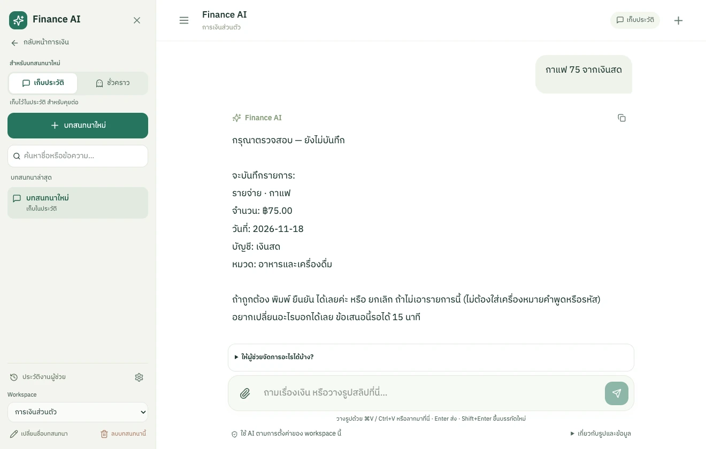
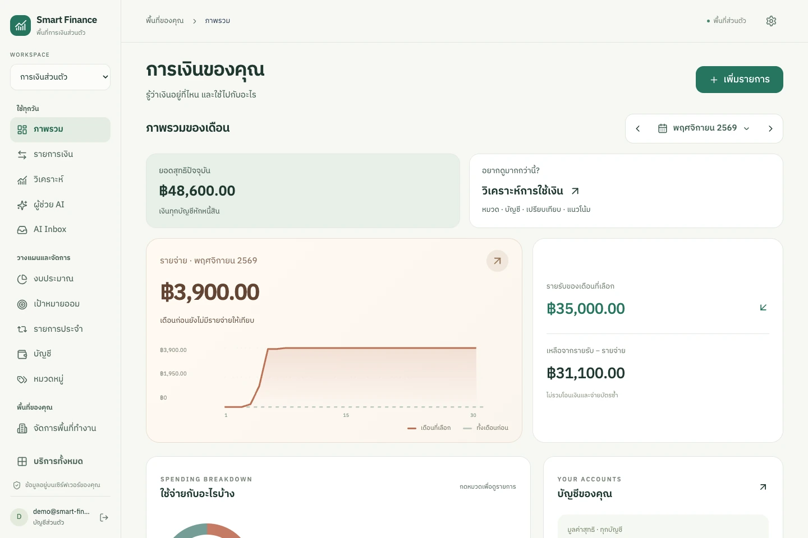
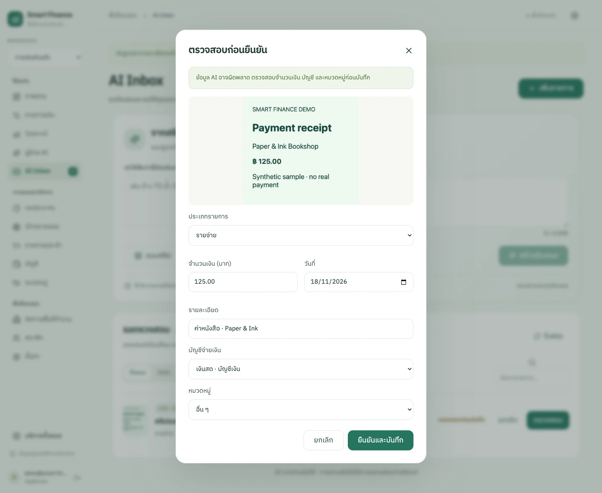
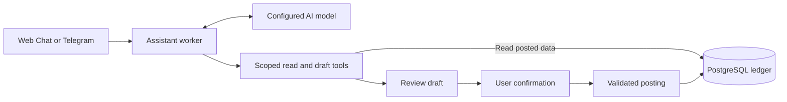

<div align="center">
  
  <h1>Smart Finance</h1>
  <p><strong>A finance assistant you can talk to in Thai and run on your own server.</strong></p>
  <p>Ask where your money went, turn a payment slip into a draft, or update a budget from chat. Review every change before it reaches your books.</p>
  <a href="https://github.com/SurakTH/smart-finance-chat/actions/workflows/pipeline.yml"></a>
</div>

[Meet the assistant](#meet-the-assistant) · [Explore the app](#explore-the-app) · [How it works](#how-it-works) · [Install](#install) · [คู่มือภาษาไทย](docs/README.md)



*A sample ฿75 coffee expense in Web Chat, waiting for the user to confirm.*

Smart Finance is a personal project built with AI-generated code and iterated through hands-on use and feedback.

## Meet the assistant

Smart Finance combines a Thai-first chat interface with a double-entry ledger. The assistant can read posted transactions, use the conversation to understand a follow-up, and prepare a change for review. You can also manage everything directly from the finance screens.

| Try saying | What happens |
| --- | --- |
| `สัปดาห์ที่แล้วใช้ไปเท่าไหร่` → `แยกตามบัญชีให้หน่อย` | Read spending from the selected workspace and keep the date range when you ask for a breakdown. Financial results can link back to the underlying records. |
| `กาแฟ 75 จากเงินสด` → `จริง ๆ 80 บาท` | Prepare a draft, then revise the amount in the same conversation. Review the updated draft and type `ยืนยัน` to post it. |
| Attach a slip and write `ค่าหนังสือ` | With a vision-capable Chat model, extract the amount and date, then prepare a draft. The assistant can suggest a category from the workspace or ask for an account or category when it needs one. |
| `แก้ค่ากาแฟเมื่อวานจาก 90 เป็น 75 บาท` | Find the posted entry, ask you to choose if several entries match, and show the correction before applying it. |
| `สร้างหมวดสัตว์เลี้ยง แล้วตั้งงบเดือนนี้ 2,000 บาท` | Prepare a linked management plan for review. Chat also supports selected account, savings-goal and recurring-schedule changes. |

These examples describe supported flows. Model-backed interpretation and receipt reading depend on the configured model. The [assistant guide](docs/AI_ASSISTANT.md) lists supported operations and examples.

**Web and Telegram.** Use the dedicated web chat to paste images, follow streamed replies, stop a response, search saved conversations or start a temporary one. A linked Telegram bot uses the workspace's Chat routing and supports text, captioned receipts and typed confirmation. Use `/new` or `/reset` on Telegram to start a fresh conversation. Telegram messages and images pass through Telegram.

## Explore the app



| Area | What you can do |
| --- | --- |
| **Transactions and accounts** | Record income, expenses, opening balances, transfers and credit-card payments. Correct or reverse a posted entry with a history of the change. |
| **Dashboard and Insights** | Browse monthly cash flow and current balances. Analyze today, yesterday, this week or a custom range by category and account, compare with the preceding period and drill into transactions. |
| **Planning** | Set category budgets and savings goals. Recurring schedules prepare proposals for review. |
| **Statement import and export** | Map CSV columns, review duplicate candidates, confirm a batch and export transactions or correction history. CSV import runs without calling an AI provider. |
| **Workspaces and offline** | Keep personal and shared workspaces separate through membership checks. Install the PWA and opt into encrypted snapshots and drafts for offline access. |

<details>
<summary>See the AI Inbox review screen</summary>



</details>

## How it works

### The model reads and proposes. The application verifies and posts.



- **Financial answers have a source.** The model selects tools for totals, transactions, trends or rankings. The backend checks the workspace and filters, calculates monetary results in SQL and can render verified figures with links to records. Pagination does not determine the totals.
- **Drafts survive follow-ups.** A partial draft can retain its amount, date and receipt while the user supplies missing details. The runtime sends bounded history and reuses repeated reads within a request. Receipt extraction sends a separate image-and-caption request, and later turns can reuse the extracted fields.
- **Writes go through the ledger.** Only an authenticated confirmation applies a reviewed change. For a transaction, the backend checks current permissions and draft state, prevents replay and records balanced debit and credit lines atomically. Amounts are integer satang. Corrections retain the original journal and its history.
- **Provider routing is configurable.** Use Ollama, Gemini, OpenRouter, Groq or an OpenAI-compatible endpoint. Share a connection across Chat and Extract model profiles, order fallbacks and set timeouts, retries, Thinking, temperature and output limits where supported. Provider keys are encrypted on the backend. The workspace's Cloud AI setting governs hosted model routes.

See the [architecture](docs/ARCHITECTURE.md), [assistant runtime](docs/AI_RUNTIME.md), [model settings](docs/MODEL_SETTINGS.md) and [AI Lab and settings guide](docs/AI_SETTINGS_HUB.md).

## Stack and verification

| Layer | Technologies |
| --- | --- |
| Web | Next.js, React, TypeScript, Tailwind CSS and Radix UI |
| API and accounting | FastAPI, SQLAlchemy, Alembic and PostgreSQL |
| Background work | Redis, Python worker and aiogram |
| Delivery | Docker Compose, Caddy or Nginx, GitHub Actions and GHCR |

- **CI/CD.** A [recorded release run from the original project](docs/VERIFICATION.md#github-actions-รอบ-63) passed 1,020 backend tests and 98 desktop/mobile browser tests. It also verified backup and restore, published AMD64 and ARM64 images and deployed to an ARM64 runner. This portfolio repository runs verification on GitHub-hosted runners. See [CI/CD](docs/CICD.md) and [Nginx](docs/NGINX.md) for self-hosting details.
- **Real-model evaluation.** One local Qwen 3.5 9B comparison on 29 messages improved from **75/79 to 78/79 checks**. Model requests went from 36 to 33 and provider-reported input tokens from 137,057 to 127,557 in that pair of runs. The [evaluation notes](docs/SMALL_MODELS.md#ผลลัพธ์เดียวสำหรับการเลือกหมวด) describe the setup, remaining failure and limits of the comparison.

## Scope

Smart Finance supports THB. Receipt extraction can misread fields and cannot verify whether a payment actually settled. Review suggested amounts, dates and categories before confirming. Offline mode covers selected snapshots and drafts. AI calls and ledger posting require connectivity to the server.

## Install

Requires Git, Python 3 and Docker with Compose v2.24.4 or newer. Clone with an account that has access if the repository is private.

```bash
git clone https://github.com/SurakTH/smart-finance-chat.git
cd smart-finance-chat
python3 scripts/configure.py
docker compose up -d --build --wait --wait-timeout 180
docker compose exec api python -m app.bootstrap
```

Open [localhost:8080](http://localhost:8080) and sign in with the account you created during setup. To configure full AI behavior, go to **บริการทั้งหมด → ศูนย์ตั้งค่า AI**, add a connection and select a Chat model that supports tools. Enable image support for a vision-capable Chat model or configure a separate Extract profile for AI Inbox.

[คู่มือภาษาไทย](docs/README.md) · [Verification](docs/VERIFICATION.md) · [Roadmap](docs/ROADMAP.md)
